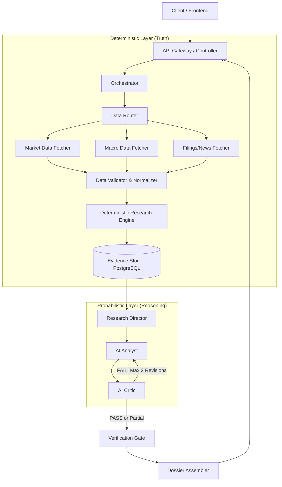

# EquiSage Target Architecture

## 1. Overview
EquiSage utilizes a **Hybrid Architecture**: a **Modular Monolith** that strictly separates deterministic data pipelines from probabilistic AI reasoning.

## 2. Target Architecture Diagram

## 3. Lifecycles

### Request Lifecycle
1. User requests research on a symbol (e.g., `RELIANCE.NS`).
2. The Request Orchestrator validates the symbol and checks the **Evidence Store** for fresh, existing data.
3. If data is stale or missing, it triggers the Data Lifecycle.
4. Once data is verified and calculated, it triggers the AI Reasoning Lifecycle.
5. The final **Investment Dossier** is assembled and returned to the user.

### Data Lifecycle (Deterministic)
1. **Fetch**: Raw source records are fetched from authoritative sources (APIs, Edgar/NSE filings).
2. **Normalize**: Data is mapped to strict EquiSage internal schemas.
3. **Validate**: Sanity checks (e.g., Price > 0, PE ratio bounds) ensure data integrity.
4. **Calculate**: The **Deterministic Research Engine** runs financial math (moving averages, peer relative valuations, risk metrics).
5. **Persist**: The verified data is saved to the **Evidence Store** (PostgreSQL) with explicit timestamps and source URLs.

### AI Reasoning Lifecycle
1. **Plan**: The **Research Director** determines the scope of the dossier.
2. **Interpret**: The **AI Analyst** receives the strict data payload (no external tools allowed at this stage) and generates interpretations, scenarios, and theses.
3. **Trace**: The Analyst must emit metadata linking its claims back to specific evidence IDs.

### Verification Lifecycle
EquiSage enforces a strict deterministic verification policy:

**Draft Thesis → AI Critic → PASS → Verified Thesis**

If the AI Critic finds issues:
**Draft Thesis → AI Critic → FAIL → Revision (Sent back to AI Analyst)**

**Revision Constraints:**
- The system allows a **maximum of 2 revision attempts**.
- If verification still fails after 2 attempts, the system **does not force approval**.
- It passes through the **Verification Gate** as a partial/unverified research result.
- The verification failure is exposed internally.
- Unsupported/conflicting claims are explicitly identified to the user.
- Critic findings are preserved in the Evidence Store for debugging and evaluation.

**PASS/FAIL Criteria:**
The AI Critic must check at minimum:
- Unsupported factual claims
- Missing evidence
- Incorrect calculations (LLM attempting unauthorized math)
- Inconsistent numbers
- Stale data being represented as current
- Source mismatch
- Contradictions within the thesis
- Unjustified valuation assumptions
- Overly strong or hyperbolic conclusions
- Missing bear-case considerations
- Hallucinated facts/events/sources

## 4. Component Responsibilities

- **Data Fetchers**: Pure integration code. No business logic.
- **Data Validator**: Enforces schema rules and handles missing fields without mocking.
- **Deterministic Research Engine**: Pure math. Never uses LLMs. Handles all financial and relative calculations.
- **Evidence Store**: PostgreSQL database acting as the durable system of record for all point-in-time facts, raw documents, and thesis versions.
- **Research Director**: High-level task planning and orchestrating the AI lifecycle.
- **AI Analyst**: Text generation, interpretation, and thesis construction based strictly on evidence.
- **AI Critic**: Adversarial validation, provenance checking, and strict enforcement of the verification criteria.
- **Verification Gate**: Final router that handles partial/unverified results when the feedback loop exhausts its revisions.

## 5. Failure Handling
- **API Outages**: If a data source fails, the system must NOT fall back to mock data. It records the field as `MISSING`. The AI Analyst is instructed to explicitly state: "Data for metric X is currently unavailable from sources."
- **LLM Rate Limits**: Handled at the infrastructure layer with retries.

## 6. Provenance Flow
Every piece of data flows downward with an attached `SourceID`. The AI Analyst must reference these `SourceID`s. The final JSON Investment Dossier maps rendered text back to the original `SourceURL`, ensuring total transparency for the user.
